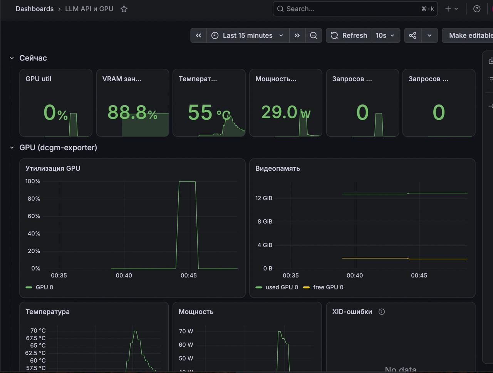
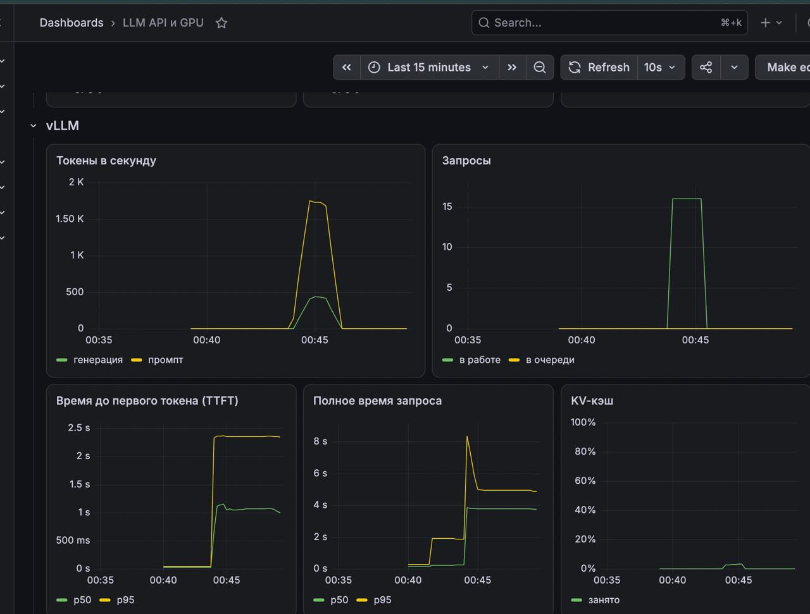
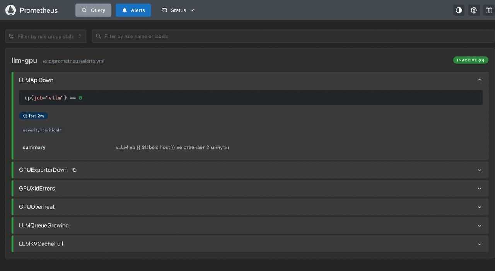

# GPU-сервер под LLM: Ansible

Плейбук готовит чистый Ubuntu-сервер с NVIDIA GPU и поднимает на нём LLM с OpenAI-совместимым API:

1. Драйвер NVIDIA из архива Ubuntu (серверная ветка R580, open-модули ядра: они нужны для Blackwell и работают на всех GPU от Turing), перезагрузка, только если драйвер поставился.
2. NVIDIA Container Toolkit и Docker Engine с compose-плагином. Runtime `nvidia` прописан в `daemon.json`.
3. vLLM v0.34.0 с моделью из Hugging Face. По умолчанию это `Qwen/Qwen2.5-1.5B-Instruct`: без токена HF, влезает в 8 ГБ видеопамяти.
4. Перед vLLM стоит nginx: TLS, allowlist по сетям, rate limit. Сам vLLM наружу не опубликован.
5. Мониторинг: dcgm-exporter (метрики GPU), Prometheus с правилами алертов и Grafana с готовым дашбордом «LLM API и GPU».
6. Watchdog: systemd-таймер перезапускает зависшие (`unhealthy`) контейнеры. Сам Docker этого не делает.
7. В конце плейбук проверяет всю цепочку: health, 401 без ключа, список моделей, настоящий запрос к модели, метрики GPU, цели Prometheus и Grafana.

Плейбук целиком проверен на реальном сервере: Ubuntu 24.04 + Tesla T4 в GCP, с Secure Boot. Результаты в разделе [«Проверено на T4»](#проверено-на-t4).

```
                      сервер (Ubuntu + NVIDIA driver + container toolkit)
 клиент ──HTTPS:443──► ┌─────────────────────── docker compose (/opt/llm) ───────────────────┐
  Bearer <key>         │  nginx ── TLS, allow CIDR, 10r/s ──► vllm:8000 (OpenAI API, GPU)    │
                       │                                        └─ /opt/llm/hf-cache (веса)  │
                       │  dcgm-exporter :9400 (метрики GPU)                                  │
                       └──────────────▲───────────────────────────▲──────────────────────────┘
                                      │ scrape        ┌───────────┴──── /opt/monitoring ───────┐
 админ ──SSH-туннель──► 127.0.0.1:3000 Grafana ◄──────┤ Prometheus :9090 (алерты) ─► vllm:8000 │
                                                      └────────────────────────────────────────┘
 systemd: docker, nvidia-persistenced, llm-watchdog.timer (раз в минуту рестарт unhealthy)
```

## Требования

Машина, с которой запускаете (control node):
- `ansible-core` 2.16 или новее;
- коллекции из `requirements.yml`;
- SSH-доступ к серверу пользователем с sudo.

Сервер:
- Ubuntu 22.04, 24.04 или 26.04, x86_64;
- GPU NVIDIA Turing и новее (T4, RTX 20xx, A10, L4, A100, H100 и т.д.). Образ vLLM v0.34 собран на CUDA 13.0, а CUDA 13 не поддерживает Maxwell, Pascal и Volta (P100, V100);
- для модели по умолчанию хватит 8 ГБ VRAM. Под 7B/8B-модели в bf16 нужно 24 ГБ и больше;
- около 40 ГБ на диске под `/opt` и `/var/lib/docker`: образ vLLM весит порядка 10 ГБ, плюс веса модели;
- выход в интернет к `archive.ubuntu.com`, `download.docker.com`, `nvidia.github.io`, Docker Hub, `nvcr.io` и `huggingface.co`.

## Запуск

```bash
ansible-galaxy collection install -r requirements.yml -p ./collections
```

```bash
cp inventory/hosts.yml.example inventory/hosts.yml
```

```bash
cp group_vars/all/vault.yml.example group_vars/all/vault.yml
```

Впишите в `vault.yml` ключ API (`openssl rand -hex 32`) и, если модель gated, токен HF. Потом зашифруйте файл:

```bash
ansible-vault encrypt group_vars/all/vault.yml
```

```bash
ansible-playbook site.yml --ask-vault-pass
```

Первый прогон занимает 10–30 минут: ставится драйвер, сервер перезагружается, скачиваются образ и веса. Повторный прогон идемпотентен (`changed=0`, около минуты). Драйвер не переустанавливается, если активны нужная ветка и тип модуля; контейнеры пересоздаются только при изменении конфигурации.

Модель, сети и прочее настраиваются в `group_vars/all/main.yml`. Все переменные с дефолтами и комментариями лежат в `roles/*/defaults/main.yml`.

Отдельные шаги можно запускать тегами: `common`, `driver`, `toolkit`, `docker`, `llm`, `monitoring`, `verify`. Например, только проверка уже развёрнутого стека:

```bash
ansible-playbook site.yml --tags verify --ask-vault-pass
```

## Как работает проверка

Роль `llm` заканчивается `tasks/verify.yml`, роль `monitoring` — своими проверками. Если любой шаг не прошёл, прогон падает:

| Шаг | Что подтверждает |
|---|---|
| `nvidia-smi` после установки и проверка версии драйвера ≥ R580 | модуль ядра загружен, драйвер подходит под CUDA 13 из образа |
| compute capability каждой GPU ≥ 7.5 | карта поддерживается CUDA 13, а не упадёт в vLLM с `no kernel image` |
| `docker run --gpus all ubuntu:24.04 nvidia-smi -L` | контейнеры видят GPU через toolkit |
| `GET /health` через nginx, ждём до 15 минут | vLLM загрузил модель в GPU |
| `GET /v1/models` без ключа → 401 | API закрыт ключом |
| `GET /v1/models` с ключом | отдаётся нужная модель |
| `POST /v1/chat/completions` | модель отвечает, ответ не пустой |
| `GET :9400/metrics` содержит `DCGM_FI_DEV_GPU_UTIL` | метрики GPU собираются |
| `promtool check config` | конфиг Prometheus и правила алертов валидны |
| все цели Prometheus в `up`, Grafana `/api/health` | мониторинг работает |

Ответ модели выводится в лог прогона:

```
TASK [llm : Show model reply]
ok: [llm-ansible-test] => msg: 'qwen2.5-1.5b: OK (37 tokens)'
```

## Ручная проверка на сервере

```bash
nvidia-smi
```

```bash
docker run --rm --gpus all ubuntu:24.04 nvidia-smi -L
```

```bash
sudo docker compose -f /opt/llm/compose.yml ps
```

```bash
sudo docker compose -f /opt/llm/compose.yml logs -f vllm
```

## Пример запроса к API

Сертификат по умолчанию самоподписанный. Для теста подойдёт `-k`, в работе выпустите нормальный сертификат (см. `llm_tls_cert_file`) или передавайте клиенту `/opt/llm/certs/tls.crt`.

```bash
export LLM_URL=https://gpu-01.example.internal LLM_KEY=<ключ из vault>
```

```bash
curl -k $LLM_URL/v1/models -H "Authorization: Bearer $LLM_KEY"
```

```bash
curl -k $LLM_URL/v1/chat/completions \
  -H "Authorization: Bearer $LLM_KEY" \
  -H "Content-Type: application/json" \
  -d '{
        "model": "qwen2.5-1.5b",
        "messages": [{"role": "user", "content": "Объясни, что такое KV-cache, в двух предложениях"}],
        "max_tokens": 200,
        "temperature": 0.2
      }'
```

Ответ приходит в формате OpenAI (`choices[0].message.content`, `usage`). Для стриминга добавьте `"stream": true`: nginx отдаёт SSE без буферизации.

Через OpenAI SDK для Python:

```python
import httpx
from openai import OpenAI

client = OpenAI(
    base_url="https://gpu-01.example.internal/v1",
    api_key="<ключ из vault>",
    http_client=httpx.Client(verify="tls.crt"),  # самоподписанный сертификат с сервера
)
resp = client.chat.completions.create(
    model="qwen2.5-1.5b",
    messages=[{"role": "user", "content": "Привет! Ответь одним словом."}],
)
print(resp.choices[0].message.content)
```

## Автозапуск и восстановление

- `docker.service` включён, у всех контейнеров `restart: unless-stopped`. После перезагрузки сервера стек поднимается сам, веса берутся из `/opt/llm/hf-cache` без повторной загрузки.
- `nvidia-persistenced` держит драйвер инициализированным, поэтому первый запрос к GPU не ждёт его инициализации.
- У vLLM есть healthcheck на `/health`. `start_period` 30 минут, чтобы первая загрузка весов не считалась сбоем. Статус видно в `docker compose ps`.
- nginx перерезолвит `vllm` через DNS Docker, так что пересоздание контейнера vLLM не ломает прокси.
- Docker не перезапускает контейнер, который жив, но не отвечает (`unhealthy`). Это делает `llm-watchdog.timer`: раз в минуту он перезапускает такие контейнеры стеков `llm` и `monitoring` и пишет об этом в journal (`journalctl -u llm-watchdog`).

## Мониторинг GPU

Роль `monitoring` поднимает в `/opt/monitoring` Prometheus и Grafana. Они слушают только `127.0.0.1`, открываются через SSH-туннель:

```bash
ssh -L 3000:127.0.0.1:3000 -L 9090:127.0.0.1:9090 ubuntu@gpu-01
```

Grafana: http://localhost:3000, пользователь `admin`, пароль из `vault_grafana_admin_password`. Если пароль не задан, плейбук генерирует его и кладёт на control node в `credentials/<host>-grafana-admin`. Дашборд «LLM API и GPU» (`roles/monitoring/files/llm-gpu.json`) открывается по умолчанию: утилизация, видеопамять, температура и мощность GPU, XID-ошибки, токены в секунду, очередь, TTFT и полное время запроса (p50/p95), заполнение KV-кэша.

Prometheus: http://localhost:9090/alerts, правила в `roles/monitoring/templates/alerts.yml.j2`:

| Алерт | Условие |
|---|---|
| `LLMApiDown` | vLLM не отдаёт метрики 2 минуты |
| `GPUExporterDown` | нет метрик GPU 5 минут |
| `GPUXidErrors` | `DCGM_FI_DEV_XID_ERRORS > 0`: аппаратная или драйверная ошибка GPU |
| `GPUOverheat` | температура GPU выше 85 °C дольше 5 минут |
| `LLMQueueGrowing` | запросы ждут в очереди 5 минут: мощности не хватает |
| `LLMKVCacheFull` | KV-кэш заполнен больше чем на 95% дольше 5 минут |

Метрика `DCGM_FI_DEV_XID_ERRORS` появляется только после первой XID-ошибки, на исправной карте её нет. Доставка алертов (Alertmanager, Slack, PagerDuty) — следующий шаг, она зависит от того, куда команда получает уведомления.

Если в компании уже есть центральный Prometheus, задайте `monitoring_enabled: false` и скрейпьте сервер оттуда. Источников метрик два:

| Источник | Адрес | Что смотреть |
|---|---|---|
| dcgm-exporter 4.8.4 | `:9400/metrics`, по умолчанию только `127.0.0.1` | `DCGM_FI_DEV_GPU_UTIL`, `DCGM_FI_DEV_FB_USED`, `DCGM_FI_DEV_GPU_TEMP`, `DCGM_FI_DEV_POWER_USAGE`, `DCGM_FI_DEV_XID_ERRORS` |
| vLLM | `https://<host>/metrics`, доступ из `llm_metrics_allowed_cidrs` | `vllm:num_requests_running`, `vllm:num_requests_waiting`, `vllm:kv_cache_usage_perc`, `vllm:time_to_first_token_seconds`, `vllm:e2e_request_latency_seconds` |

dcgm-exporter запинен на 4.8.4 намеренно. В 4.9.0 переименованы метрики и поменялись единицы (утилизация стала долей, память считается в байтах), из-за чего готовые дашборды ломаются. Обновлять его стоит вместе с дашбордами и алертами.

Чтобы внешний Prometheus мог забирать метрики, задайте `llm_dcgm_exporter_listen_address` равным внутреннему IP сервера. Пример scrape-конфига:

```yaml
scrape_configs:
  - job_name: dcgm
    static_configs:
      - targets: ["10.0.10.21:9400"]
  - job_name: vllm
    scheme: https
    tls_config:
      insecure_skip_verify: true   # или ca_file с сертификатом сервера
    static_configs:
      - targets: ["10.0.10.21:443"]
```

Дашборд и алерты из роли `monitoring` можно импортировать туда же.

## Безопасность API

- **Ключ.** vLLM без Bearer-ключа (`VLLM_API_KEY`) возвращает 401 на `/v1/*`. Ключ лежит в Ansible Vault, на сервере хранится в `/opt/llm/.env` с правами 0600. Задачи, где он участвует, помечены `no_log`, поэтому в лог прогона он не попадает.
- **TLS.** Трафик терминирует nginx, доступны только TLS 1.2 и 1.3. Можно подложить свой сертификат или оставить самоподписанный.
- **Минимум наружу.** Порт 8000 vLLM не публикуется. Снаружи доступны только `/v1/*`, `/health` и `/metrics` (последний только из `llm_metrics_allowed_cidrs`), всё остальное отдаёт 404.
- **Сети и rate limit.** nginx пускает к `/v1/` только адреса из `llm_allowed_cidrs` и ограничивает частоту запросов: 10 r/s, burst 20, сверх этого 429. Внешние клиенты приходят в nginx со своим настоящим адресом (Docker делает DNAT без подмены источника). Запросы с самого сервера и из его контейнеров nginx видит с адреса шлюза сети compose (`llm_docker_gateway`), и они разрешены всегда: так работают проверки плейбука. Значит, локальные пользователи сервера считаются доверенными, ключ API им всё равно нужен.
- **UFW и Docker.** UFW включён с политикой deny на входящие, разрешён только SSH из `common_ssh_allowed_cidrs`. Учтите важную деталь: Docker пишет свои правила iptables, и UFW **не фильтрует** опубликованные порты контейнеров. Поэтому доступ к API ограничивается в nginx, а dcgm-exporter по умолчанию слушает только `127.0.0.1`. Если нужен фильтр именно на уровне файрвола, правила надо писать в цепочку `DOCKER-USER`.

## Проверено на T4

Стенд: GCP `n1-standard-4` + 1× Tesla T4 (16 ГБ, compute 7.5), Ubuntu 24.04.5 LTS, ядро `7.0.0-gcp`, **Secure Boot включён**. Плейбук прогонялся на чистой ВМ. Полные выводы со стенда по каждой проверке: [docs/test-run.md](docs/test-run.md).

| Что проверяли | Результат |
|---|---|
| Полный прогон с нуля | драйвер 580.178.04, open-модуль ядра (`Dual MIT/GPL`), перезагрузка, toolkit, Docker, vLLM, nginx, мониторинг — `failed=0` |
| Secure Boot | подписанные Canonical модули грузятся, `nvidia-smi` видит T4 |
| Идемпотентность | повторный прогон: `changed=0`, 1 минута |
| `nginx -t` | конфиг валиден |
| API | `/health` 200; без ключа и с неверным ключом 401; `/v1/models` и `/v1/chat/completions` с ключом 200; стриминг SSE отдаёт токены по одному |
| Allowlist | клиент с адреса вне `llm_allowed_cidrs` (35.235.240.x): `/v1/*` и `/metrics` → 403; после добавления сети в переменную и прогона роли → 200 |
| Rate limit | 25 запросов залпом: 22 × 200, 3 × 429 |
| Закрытые пути | `/` и `/docs` → 404; наружу слушают только 22 и 443, vLLM (8000) не опубликован |
| Перезагрузка сервера | все контейнеры поднялись сами через 24 с после загрузки, `--tags verify` зелёный |
| Watchdog | процесс vLLM заморожен (`SIGSTOP`) → `unhealthy` через ~1 мин → watchdog перезапустил контейнер → `healthy` через ~1 мин (модель из локального кэша) |
| Мониторинг | цели `vllm`, `dcgm`, `prometheus` в `up`, 6 правил алертов загружены, дашборд показывает нагрузку |

Бенчмарк (`vllm bench serve` внутри контейнера, модель Qwen2.5-1.5B-Instruct, 300 запросов, промпт 512 токенов, ответ 128, до 16 параллельно):

| Метрика | Значение |
|---|---|
| Ошибок | 0 из 300 |
| Пропускная способность | 3,3 запроса/с; 423 ток/с на генерации (пик 704), 2209 ток/с всего |
| Время до первого токена | p50 1,0 с, p95 1,2 с, p99 1,9 с |
| Время на токен | p50 30 мс, p95 36 мс (около 33 ток/с на поток) |
| Полный запрос | p50 4,8 с, p95 4,9 с, p99 5,3 с |

Дашборд Grafana во время бенчмарка и правила алертов в Prometheus:







Найдено и исправлено по ходу прогона:
- самоподписанный сертификат не выпускался: FQDN в GCP длиннее 64 символов, а это лимит поля CN. Теперь в CN короткое имя хоста, полное — в subjectAltName;
- nginx предупреждал, что `worker_connections 4096` больше лимита открытых файлов (1024). Лимит контейнера поднят до 65535.

## Проверка без GPU

На машине без GPU плейбук намеренно останавливается на первой задаче роли `nvidia_driver` с сообщением `No NVIDIA GPU found`. Остальное проверяется статически:

```bash
ansible-playbook site.yml --syntax-check
```

```bash
ansible-lint --profile production
```

```bash
yamllint .
```

Все три проверки проходят без ошибок.

## Что улучшить дальше

- **Несколько моделей и учёт клиентов.** Поставить перед vLLM шлюз вроде LiteLLM: по ключу на команду, квоты и бюджеты, роутинг по моделям и фолбэк на внешние API.
- **Большие модели.** Для моделей больше одной карты есть `llm_tensor_parallel_size`. Квантизация (AWQ, FP8) через `llm_extra_args` позволяет уместить 70B на 2×H100.
- **Кэш весов.** Веса стоит держать на отдельном NVMe-диске или во внутреннем зеркале HF/S3, чтобы новые серверы не качали их из интернета.
- **Отказоустойчивость.** Сделать несколько GPU-серверов за балансировщиком. Для вывода узла из ротации использовать `/health`, выкатывать по одному узлу (`serial: 1`).
- **Обновления драйвера.** `unattended-upgrades` может обновить userspace драйвера без перезагрузки, после чего до ребута будет `Driver/library version mismatch`. Ветку драйвера лучше обновлять только этим плейбуком, с плановой перезагрузкой.
- **Тесты роли.** Molecule-сценарий на GPU-раннере в CI: та же проверка, что выше на T4, но на каждый MR.
- **Ключ на клиента.** Сейчас ключ один на всех. Если шлюз не нужен, nginx может проверять список ключей (`map $http_authorization`) и писать в лог, какой клиент сделал запрос.
- **Kubernetes.** Если GPU-серверов станет много, перейти на GKE/k8s с NVIDIA GPU Operator. Он сам ставит драйвер, toolkit и DCGM, а модели раскатываются через KServe или vLLM production-stack.

## Структура

```
site.yml                      # плейбук: common → nvidia_driver → nvidia_toolkit → docker → llm → monitoring
group_vars/all/main.yml       # основные настройки
group_vars/all/vault.yml      # секреты (шаблон: vault.yml.example)
inventory/hosts.yml           # сервера (шаблон: hosts.yml.example)
roles/common                  # проверка ОС, базовые пакеты, UFW
roles/nvidia_driver           # драйвер R580-server (open-модули), Fabric Manager (опционально), persistenced
roles/nvidia_toolkit          # NVIDIA Container Toolkit
roles/docker                  # Docker CE, daemon.json с runtime nvidia и ротацией логов
roles/llm                     # compose: vLLM + nginx + dcgm-exporter, watchdog, проверка (verify.yml)
roles/monitoring              # Prometheus + Grafana: алерты, дашборд «LLM API и GPU»
```
